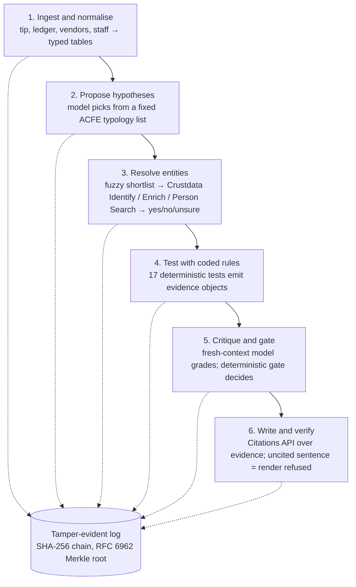

# Casefile

**Demo video:** _link here by 15:15_

**Every fake caught, no honest business turned away, every fact traceable.** Casefile is an autonomous forensic-audit agent. Give it an insider tip, a company's ledger, its vendor master and its staff list, and it returns an audit-committee case file: every allegation **Substantiated**, **Unfounded** or **Unsubstantiated**, every sentence cited to a ledger row or a Crustdata record, and every tool call in a hash-chained, verifiable log. No human steps between the command and the file.

Built in five hours at ContextCon 03, IIT Bombay (31 Oct 2026), on Crustdata's identity graph.

## One command

```bash
cp .env.example .env   # CRUSTDATA_API_KEY, ANTHROPIC_API_KEY
uv sync
uv run casefile investigate --tip cases/demo/tip.txt --ledger cases/demo/ledger.csv \
  --vendors cases/demo/vendors.csv --staff cases/demo/staff.csv --out out/demo/
python verify.py out/demo/log.jsonl
```

Outputs in `out/demo/`: `case_file.md` (the report, in ACFE order), `exhibits.md` (every cited evidence object, quoted verbatim), `evidence.json`, `findings.json`, `log.jsonl` (the hash-chained log), `root.txt` (Merkle root and record count).

| flag | effect |
| --- | --- |
| `--offline` | Crustdata answers come only from the disk cache (`.cache/crustdata/`); the log records `cache_hit: true` |
| `--redact` | person names become initials in the rendered files; ids and Crustdata record ids stay |
| `--case-id`, `--company` | title-block labels |

Exit codes: `0` ok, `2` a sentence without valid evidence (render refused), `3` log verification failed. `uv run casefile credits` shows the Crustdata balance.

## How it works



Rules detect, the model proposes and explains, the log anchors everything. The rule registry, with named and cited thresholds printed in every case file, is a company's rules turned into checks the agent runs and cites. Design notes and sources: `docs/research-brief.md`.

## Crustdata endpoints used

`POST /company/identify` (free, resolves messy vendor names), `POST /company/enrich` (by Crustdata id only: headcount, founding year, website, HQ, founders), `POST /company/search` (the record's `updated_at` for citations, which Enrich leaves empty), `POST /person/search` (name + employer, exact mode), `POST /person/enrich` (career history with dates), `GET /account/credits`. Every response is cached with its `X-Request-Id` and credits used, and every record is cited as `crustdata:<kind>:<id>@<updated_at>`. 429s back off on `X-RateLimit-Reset`.

## Evaluation on planted cases

_Generated by `uv run python tests/eval_harness.py` (writes `out/eval/eval.md`): every case in `cases/`, three runs each (run 1 live, runs 2 and 3 from the cache). Pasted here at 14:15._

| case | fakes caught (per run) | honest businesses turned away | allegations correct | precision | citation validity | log verifies |
| --- | --- | --- | --- | --- | --- | --- |
| | | | | | | |

## Verify the log

```bash
python verify.py out/demo/log.jsonl            # standard library only, works from a fresh clone
uv run casefile verify out/demo/log.jsonl      # same check, exit 3 on failure
```

Both recompute every record hash (RFC 8785 canonical JSON, SHA-256), the `prev_hash` chain, pre/post pairing and the RFC 6962 Merkle root against `root.txt`. Change one byte of any record and verification fails, naming its `seq`. Delete the last record and the root no longer matches.

## How false accusations are avoided

- The model never decides a verdict. A deterministic gate does: **Substantiated** needs ≥ 2 supporting evidence objects from ≥ 2 test families, each with strength ≥ 0.6, and no strong refutation. When the gate overrides the model, the log records why.
- An unresolved vendor or person forces **Unsubstantiated**, and the gap is listed in the case file.
- Tests emit refuting evidence too (a vendor with 50+ staff and a website is not a shell; a shared coworking address is not a link by itself).
- A sentence without an evidence id, or an id whose quote does not appear in its hashed source, blocks the render.

## Team

**Builder**: Tejash Chauhan and Kedar Sharma.
