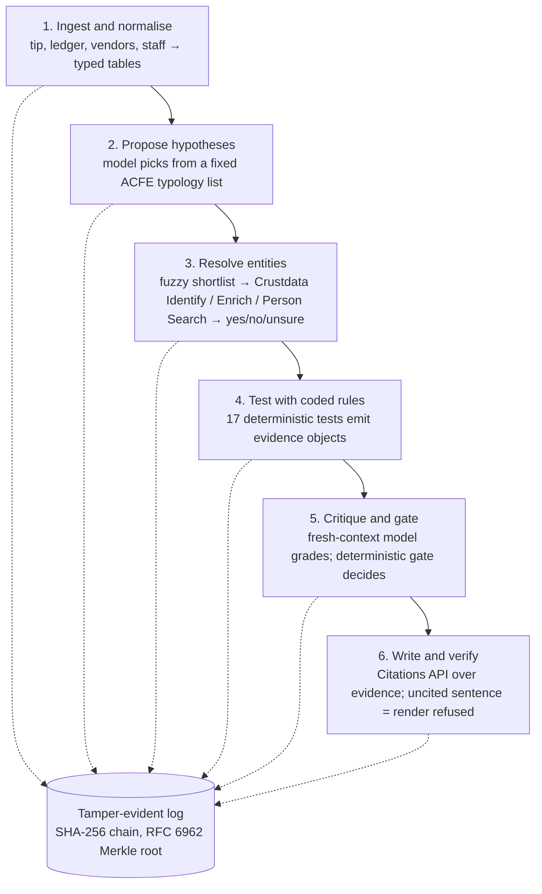

# Casefile

**Demo video:** _link here by 15:15_

**Every fake caught, no honest business turned away, every fact traceable.** Casefile is an autonomous forensic-audit agent. Give it an insider tip, a company's ledger, its vendor master and its staff list, and it returns an audit-committee case file: every allegation **Substantiated**, **Unfounded** or **Unsubstantiated**, every sentence cited to a ledger row or a Crustdata record, and every tool call in a hash-chained, verifiable log. No human steps between the command and the file.

Built in five hours at ContextCon 03, IIT Bombay (31 Oct 2026), on Crustdata's identity graph.

## One command

```bash
cp .env.example .env   # CRUSTDATA_API_KEY, ANTHROPIC_API_KEY
uv sync
uv run casefile investigate --tip cases/career_overlap/tip.txt \
  --ledger cases/career_overlap/ledger.csv --vendors cases/career_overlap/vendors.csv \
  --staff cases/career_overlap/staff.csv --out out/career_overlap/
python verify.py out/career_overlap/log.jsonl
```

Any of the six cases in `cases/` runs the same way. Outputs in `out/<case>/`: `case_file.md` (the report, in ACFE order), `exhibits.md` (every cited evidence object, quoted verbatim), `evidence.json`, `findings.json`, `log.jsonl` (the hash-chained log), `root.txt` (Merkle root and record count).

| flag | effect |
| --- | --- |
| `--offline` | Crustdata answers come only from the disk cache (`.cache/crustdata/`); the log records `cache_hit: true` |
| `--redact` | person names become initials in the rendered files; ids and Crustdata record ids stay |
| `--case-id`, `--company` | title-block labels |

Exit codes: `0` ok, `2` a sentence without valid evidence (render refused), `3` log verification failed. `uv run casefile credits` shows the Crustdata balance.

## How it works



Rules detect, the model proposes and explains, the log anchors everything. The rule registry, with named and cited thresholds printed in every case file, is a company's rules turned into checks the agent runs and cites. Design notes and sources: `docs/research-brief.md`.

## Crustdata: endpoints, rate limits, credits, citations

- **Endpoints.** `POST /company/identify` (free) resolves each vendor: website domain first, then exact name, then fuzzy name. `POST /company/enrich` runs only on accepted company ids, 25 per call, requesting only the fields our tests read. `POST /company/search` supplies each company record's own `updated_at`. `POST /person/enrich` reads a staff member's LinkedIn profile, and `POST /person/search` (exact mode, name plus the audited company) covers staff without one. `GET /account/endpoints` checks at start-up which endpoints and fields our key may use. `/person/identify` and the `batch_*` endpoints are not on our plan and are never called.
- **No guessing.** A top match on name alone is never accepted ("Infosys" returns six matches at confidence 1.0). We need the vendor's website domain, or the only company with that exact name and no conflicting HQ country, or a model "yes" on a short tie list. Same-name people who never worked at the audited company are counted and left `ambiguous`, never attached to our staff. An unresolved entity is a legal state; it voids only the evidence that would have rested on its record.
- **Rate limits and 429.** Each endpoint has a sliding 60-second window set to the server's limit (Enrich 15, Identify and Search 30 requests per minute). On a 429 we wait for `X-RateLimit-Reset` or `Retry-After` plus jitter and retry, at most 5 tries; 5xx errors retry the same way. 402 (no credits) and 403 (not on plan) stop at once.
- **Credits and cache.** Every response is stored under the SHA-256 of its request, together with `X-Request-Id` and `X-Credits-Used`. A planted case costs about 25 credits on a cold cache and 0 once cached, and `--offline` replays the same result without a network. Batched responses are also cached per company, so a run that asks for a different set of companies still replays.
- **Citations.** Every Crustdata fact is cited as `crustdata:company:<id>@<updated_at>` or `crustdata:person:<id>@<updated_at>`, using the record's own timestamp. When a record has none, we cite the time we fetched it and list that under Data quality. Every call writes a before and after audit-log record with the request hash, result hash, credits and request id.

## Evaluation on planted cases

Six planted cases (`cases/README.md`), three runs each: run 1 live against Crustdata from a cold cache, runs 2 and 3 replayed from the cache with `--offline`. A case passes only if all three runs give every expected verdict. Reproduce with `uv run python tests/eval_harness.py` (writes `out/eval/eval.md`).

| case | fakes caught (per run) | honest businesses turned away | allegations correct | precision | citation validity | log verifies | wall time (s) | credits | result |
| --- | --- | --- | --- | --- | --- | --- | --- | --- | --- |
| career_overlap | 1/1, 1/1, 1/1 | 0 | 3/3 | 100% | 100% | 3/3 | 64.5 | 23.82 | **pass 3/3** |
| clean_controls | 0/0, 0/0, 0/0 | 0 | 0/0 | n/a | 100% | 3/3 | 50.6 | 4.71 | **pass 3/3** |
| duplicate_billing | 1/1, 1/1, 1/1 | 0 | 3/3 | 100% | 100% | 3/3 | 45.8 | 2.03 | **pass 3/3** |
| false_lead | 0/0, 0/0, 0/0 | 0 | 3/3 | n/a | 100% | 3/3 | 54.6 | 3.03 | **pass 3/3** |
| shared_office_honest | 0/0, 0/0, 0/0 | 0 | 0/0 | n/a | 100% | 3/3 | 51.6 | 6.09 | **pass 3/3** |
| shell_vendor | 2/2, 2/2, 2/2 | 0 | 6/6 | 70% | 100% | 3/3 | 55.5 | 0 | **pass 3/3** |

**Fakes caught**: planted allegations found Substantiated. **Honest businesses turned away**: vendors that must be cleared but got any Substantiated finding (target 0). **Allegations correct** counts every expected verdict, including the expected **Unfounded** for the tip's false lead. **Precision**: share of Substantiated findings that match a planted allegation; `shell_vendor`'s 70% is an extra "kickback" finding on the planted shell, where the vendor is the approver's own company (shared phone and address), not a third party paying him; T01 now refutes kickback in that case, and this row will be re-run with it. Wall time is per run, credits are for the cold run 1 (`shell_vendor` reuses companies already fetched by earlier cases). Run on commit `4283519`; `shell_vendor` re-scored against its final `case.json` (`d0ffe03`, inputs unchanged).

## Verify the log

```bash
python verify.py out/demo/log.jsonl            # the committed demo run; standard library only
uv run casefile verify out/demo/log.jsonl      # same check, exit 3 on failure
```

Both recompute every record hash (RFC 8785 canonical JSON, SHA-256), the `prev_hash` chain, pre/post pairing and the RFC 6962 Merkle root against `root.txt`. Change one byte of any record and verification fails, naming its `seq`. Delete the last record and the root no longer matches.

## How false accusations are avoided

- The model never decides a verdict. A deterministic gate does: **Substantiated** needs ≥ 2 supporting evidence objects from ≥ 2 test families, each with strength ≥ 0.6, and no strong refutation. When the gate overrides the model, the log records why.
- An unresolved vendor or person forces **Unsubstantiated**, and the gap is listed in the case file.
- Tests emit refuting evidence too (a vendor with 50+ staff and a website is not a shell; a shared coworking address is not a link by itself).
- A sentence without an evidence id, or an id whose quote does not appear in its hashed source, blocks the render.

## Team

**Builder**: Tejash Chauhan and Kedar Sharma.
