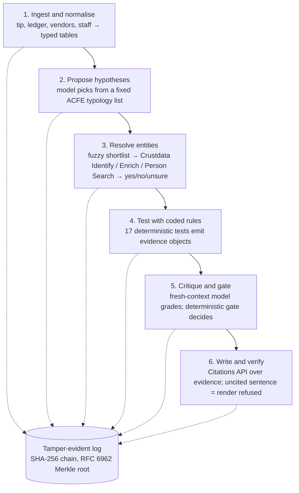

# Casefile

**Demo video:** _link here by 15:15_

**Every fake caught, no honest business turned away, every fact traceable.** Casefile is an autonomous forensic-audit agent. Give it an insider tip, a company's ledger, its vendor master and its staff list, and it returns an audit-committee case file: every allegation **Substantiated**, **Unfounded** or **Unsubstantiated**, every sentence cited to a ledger row or a Crustdata record, and every tool call in a hash-chained, verifiable log. No human steps between the command and the file.

Built in five hours at ContextCon 03, IIT Bombay (31 Oct 2026), on Crustdata's identity graph.

## One command

```bash
cp .env.example .env   # CRUSTDATA_API_KEY, ANTHROPIC_API_KEY
uv sync
uv run casefile investigate --tip cases/demo/tip.txt --ledger cases/demo/ledger.csv \
  --vendors cases/demo/vendors.csv --staff cases/demo/staff.csv --out out/demo/
python verify.py out/demo/log.jsonl
```

Outputs: `out/demo/case_file.md`, `exhibits.md`, `evidence.json`, `log.jsonl`, `root.txt`.

## How it works



Rules detect, the model proposes and explains, the log anchors everything. The rule registry, with named and cited thresholds printed in every case file, is a company's rules turned into checks the agent runs and cites. Design notes and sources: `docs/research-brief.md`.

## Crustdata endpoints used

`POST /company/identify` (free, resolves messy vendor names), `POST /company/enrich` (headcount, founding year, website, HQ, founders), `POST /person/search` (name + employer, exact mode), `POST /person/enrich` (career history with dates), `GET /account/credits`. Every record is cited as `crustdata:<kind>:<id>@<updated_at>`.

## Evaluation on planted cases

_Table generated by `uv run python tests/eval_harness.py` (out/eval/eval.md); pasted here at 14:15._

| case | planted | fakes caught (3 runs) | honest businesses turned away | citation validity |
| --- | --- | --- | --- | --- |
| | | | | |

## Verify the log

`python verify.py out/demo/log.jsonl` recomputes every record hash, the chain and the Merkle root (standard library only). Change one byte and it fails, naming the record.

## Team

Two builders, IIT Bombay: _names here_.
